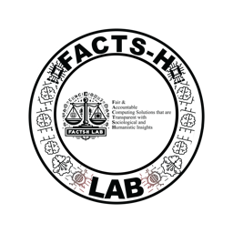
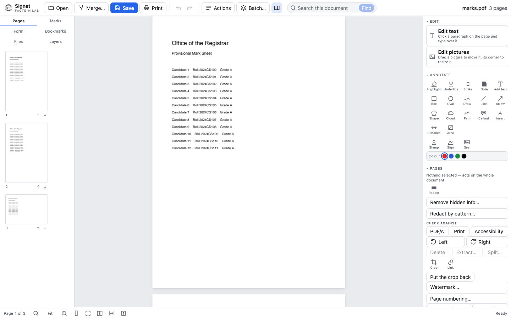

<picture>
  <source media="(prefers-color-scheme: dark)" srcset="docs/lockup-light.png">
  
</picture>

# Signet

**Privacy-preserving PDF editor from FACTS-H Lab**

*Your files never leave your computer.*

[**Try it in your browser →**](https://ebinrajiiit.github.io/pdf_suite/) &nbsp;·&nbsp; [**Download →**](https://github.com/ebinrajiiit/Signet/releases/latest)

---

## Every PDF tool wants your documents. This one never asks.

Open a mark sheet in Acrobat's online tools and it goes to a server in another
country. For a university registrar, an exam cell or a district office, that is
not a preference — it is often the end of the conversation.

Signet does what Acrobat does — read, edit, annotate, reorganise, OCR, redact,
convert, fill and check a PDF — and does all of it **on the machine in front of
you**. There is no server, no account, no telemetry, no analytics, no CDN, no
web font. The entire engine is compiled to WebAssembly and runs inside the
window.

You do not have to take that on faith. **Turn off your Wi-Fi and keep working.**
Everything keeps running.

## What it does

| | |
| --- | --- |
| **Read** | 500-page files, real text layer, search that matches Malayalam and Hindi whichever form the document uses |
| **Edit** | Click a paragraph and type over it — the text changes in the document itself, keeping its font and re-wrapping to its own width |
| **Mark up** | Nineteen kinds of annotation, comment threads, XFDF in and out |
| **Organise** | Merge, reorder, rotate, split, crop, watermark, bookmarks, Bates numbering |
| **Forms** | Fill, flatten, and build fields — with calculations done by our code, never by JavaScript carried in the document |
| **Read scans** | OCR in English, Malayalam and Hindi, with despeckling that turns an unreadable scan into a readable one |
| **Redact** | Content truly removed, then the file re-read to prove no text survived. Find Aadhaar, PAN, phone and email by pattern |
| **Convert** | To Word with real tables, to CSV, to text, to images — and from images, a scanner, Word or Excel |
| **In bulk** | Grade cards, certificates and result sheets from a template and a spreadsheet |

## Why it is built here

**The documents often cannot leave.** An institution that hands student or
patient records to a third-party service takes on a processor relationship under
the DPDP Act, 2023. Signet never receives the document, so the relationship
never forms.

**Indic scripts are the reason the OCR exists**, not an entry in a locale list.
Malayalam extraction is verified against forty real documents from Kerala LSGD
and the Kerala Assembly.

**It works where the network does not** — campus offices, district offices,
examination halls. Offline by construction, not offline as a degraded mode.

**It is auditable.** An institution should be able to check the privacy claim of
the software holding its students' records without taking anyone's word for it.

## Download

Pick the line that matches your computer. The download starts as soon as you
click, and the next section says what to do with the file.

<!-- downloads:start -->
| Your computer | Click to download | Size |
| --- | --- | --- |
| **Mac** — any Mac, Intel or Apple silicon | **[Signet_0.1.1_universal.dmg](https://github.com/ebinrajiiit/Signet/releases/download/v0.1.1/Signet_0.1.1_universal.dmg)** | 30 MB |
| **Windows** — 10 or 11 | **[Signet_0.1.1_x64_en-US.msi](https://github.com/ebinrajiiit/Signet/releases/download/v0.1.1/Signet_0.1.1_x64_en-US.msi)** | 14 MB |
| **Linux** — Ubuntu, Debian, Mint, Pop!_OS | **[Signet_0.1.1_amd64.deb](https://github.com/ebinrajiiit/Signet/releases/download/v0.1.1/Signet_0.1.1_amd64.deb)** | 14 MB |
| **Linux** — Fedora, Arch, openSUSE, anything else | **[Signet_0.1.1_amd64.AppImage](https://github.com/ebinrajiiit/Signet/releases/download/v0.1.1/Signet_0.1.1_amd64.AppImage)** | 94 MB |
| **A whole office** — serve it from your own machine | **[signet-web.tar.gz](https://github.com/ebinrajiiit/Signet/releases/download/v0.1.1/signet-web.tar.gz)** | 12 MB |

Signet 0.1.1 · [every file, with checksums](https://github.com/ebinrajiiit/Signet/releases/tag/v0.1.1)
<!-- downloads:end -->

### What to do with the file you just got

- **Mac (`.dmg`)** — open it and drag **Signet** into Applications.
- **Windows (`.msi`)** — double-click it and follow the installer.
- **Linux (`.deb`)** — double-click it, or `sudo apt install ./Signet_*.deb`
- **Linux (`.AppImage`)** — `chmod +x Signet_*.AppImage`, then run it. Nothing
  is installed: the single file is the whole program.
- **`signet-web.tar.gz`** — unpack it into any folder your web server serves,
  and everyone on your network can use Signet in a browser, still with nothing
  leaving their own machine. No database, no backend, no configuration.

---

### The first time you open it, your computer will warn you

Signet is not code-signed yet — that needs a paid certificate from Apple and
from a Windows authority, which is on the list. Until then both systems say an
unidentified developer made this. It is us, and here is how to get past it:

- **macOS:** right-click (or Control-click) **Signet** in Applications and
  choose **Open**, then **Open** again in the dialog. Only needed once.
  Double-clicking the first time gives you no Open button, which is why this
  looks worse than it is.
- **Windows:** SmartScreen shows a blue box. Click **More info**, then
  **Run anyway**.

If you would rather verify the download first, every release includes
`SHA256SUMS`. Compare it with `shasum -a 256 <file>` on macOS or Linux, or
`Get-FileHash <file>` in Windows PowerShell.

Each build is large because it carries its own OCR language data for English,
Malayalam and Hindi, rather than fetching them later — which is exactly why OCR
keeps working with the network switched off.

## Try it first

**[ebinrajiiit.github.io/pdf_suite →](https://ebinrajiiit.github.io/pdf_suite/)**

The same app, with one thing removed: it will not write a file. Open a PDF,
edit it, mark it up, redact it, run OCR — and when you want to keep the result,
install it. Nothing you open there is uploaded; there is nowhere for it to go.

## Honestly, what is missing

- **Cryptographic signing** — Class 3 DSC over PKCS#11 and Aadhaar eSign. The
  panel reads signatures today; it cannot yet make one. This is next.
- **Accessibility tagging** and PDF/UA validation. The check is done; the tag
  tree is not.
- **Windows and Linux builds are new** and have had far less use than macOS.
- **PDF/A is checked, not converted.**

## Built with

PDFium for rendering, qpdf for repair and encryption, Tesseract for OCR, pdf-lib
for structure, Tauri for the desktop shell. Every one permissively licensed and
carried inside the build rather than fetched. Licences are in
`THIRD_PARTY_NOTICES.txt` in each release.

## Who made it

**FACTS-H Lab**, Indian Institute of Information Technology, Kottayam.

A signet is the seal ring that authenticates a document.

